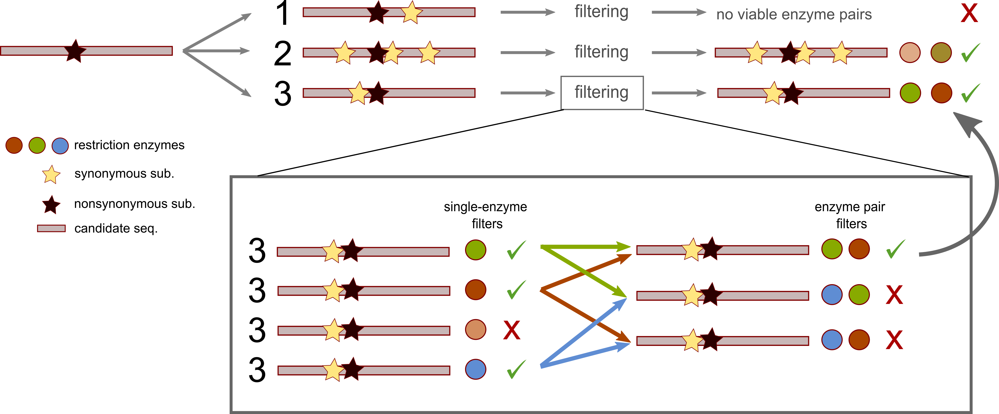

# TIARS-Designer

## Overview

TIARS (Test for Added Recognition Sites) Designer generates a list of potential CRISPR repair oligo candidates for a provided locus that introduce silent restriction fragment length polymorphisms (RFLPs) for two distinct restriction enzymes in addition to the desired edit. This allows users to:

- Consider all viable combinations of synonymous edits and restriction enzymes to use in an easy to view Word document.

- Automate the process of filtering out inviable candidate sequences and restriction enzyme pairs (see [Filters](https://nichd-bspc.github.io/tiars-designer/filters.html) for complete descriptions of the filters).

- Rank the outputted candidate sequence/Restriction enzyme combinations based on statistics such as the departure in codon frequency of the candidate sequence from the endogenous sequence (see [Interpreting the Output](https://nichd-bspc.github.io/tiars-designer/output.html) for the full list).

## Why use this tool?

An important part of any CRISPR/Cas homology-directed repair experiment is being able to verify that the experiment was successful and the desired edit was incorporated. Introducing RFLPs to the repair via synonymous (silent) substitutions to the repair oligo is one way to do so, as digestion with the enzymes that correspond to the RFLPs would reveal whether or not the repair oligo containing the edit and novel restriction sites was incorporated. TIARS Designer automates the process of figuring out where best to introduce the silent RFLPs, which is a time consuming and error prone process to do by hand.

## Workflow

The tool runs three main steps:

1. Generates a list candidate sequences containing all possible combinations of silent mutations within 15 bp on either side of the Cas protein cutsite.

2. For each candidate sequence, finds restriction enzymes that have a restriction site in the candidate sequence that's not in the endogenous sequence, and filters out enzymes that would not work well with that sequence. Outputs all sequence + restriction enzyme combinations that passed all of the filters.

3. For each candidate sequence, any enzymes that haven't been filtered out are paired together in all possible combinations, and filtered on the enzyme pair level based on the compatibility of the pair with the sequence. Outputs all sequence + restriction enzyme pair combinations that passed all the pair filters as the final output.

**For more informatiion, see the documentation at https://nichd-bspc.github.io/tiars-designer/.**
