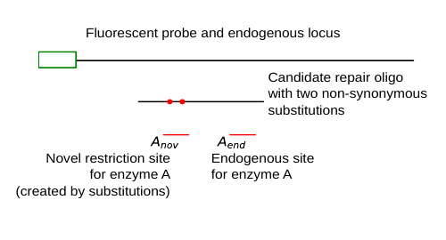
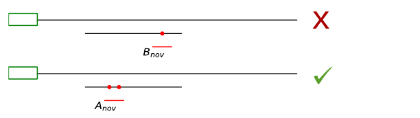
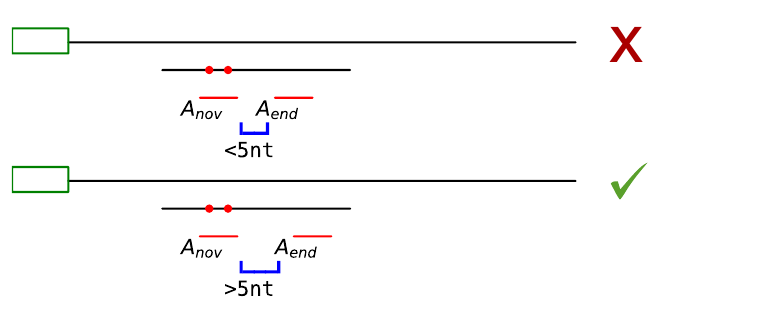
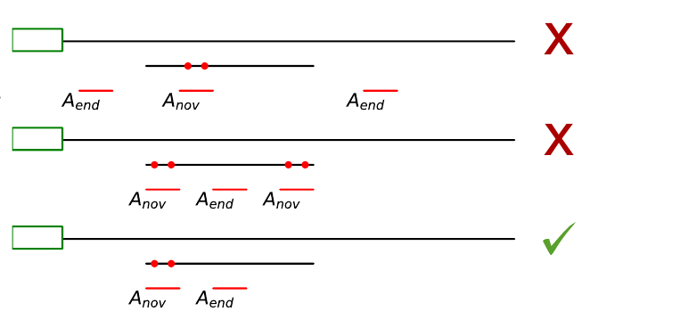
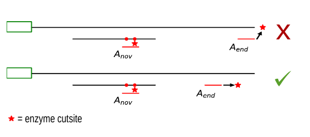
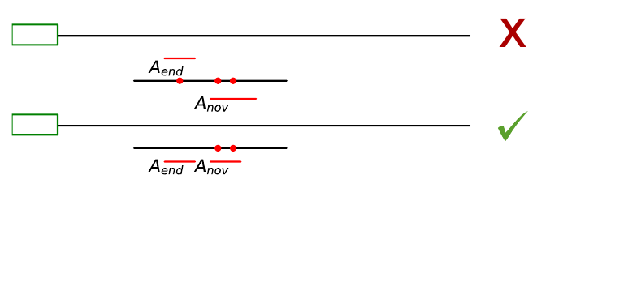
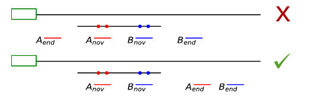
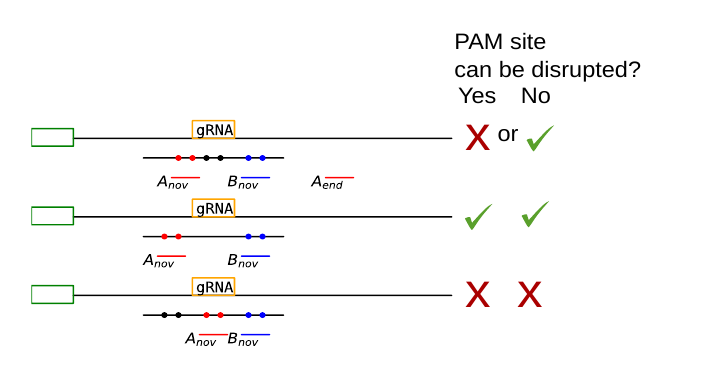
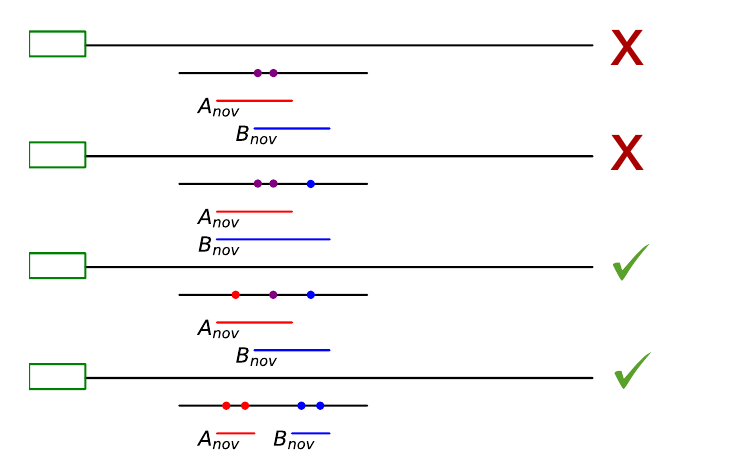
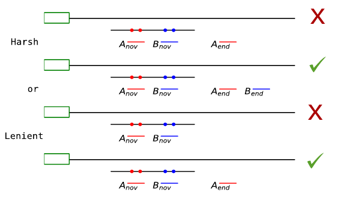

=======
Filters
=======

Each candidate goes through two rounds of filtering: first the single restriction enzyme filters and then the enzyme pair filters.

Figure Key
----------
Use this key to interpret the following figures.

Single Restriction Enzyme Filters
---------------------------------
These filters take a candidate sequence and a single restriction enzyme as their inputs. They make up the first round of filtering.

Novel site depends on at least two substitutions
~~~~~~~~~~~~~~~~~~~~~~~~~~~~~~~~~~~~~~~~~~~~~~~~

Any novel, substitution dependent recognition site in the repair oligo should depend on at least two substitutions for the restriction enzyme to recognize it. In other words, at least two substitutions need to be made in the candidate oligo to create a novel recognition site for the restriction enzyme. If a recognition site depends on only one substitution, there's a higher chance that its recognition site could be created by chance due to the mutagenic nature of CRISPR/Cas activity, yielding false positive results.

See :ref:`Figure Key`

No endogenous cutsites within N nucleotides of a novel cutsite
~~~~~~~~~~~~~~~~~~~~~~~~~~~~~~~~~~~~~~~~~~~~~~~~~~~~~~~~~~~~~~

For each enzyme there should be at least N nucleotides between any endogenous cutsites and novel cutsites, where N is the value is the value of the optional --min_Rsite_distance argument (default = 5bp). If a candidate has a novel site that's too close to an endogenous site, the fragment created by digestion of the endogenous sequence would be very close in length to the fragment created by digestion of the candidate sequence. This would make it difficult to discern whether or not the CRISPR/Cas activity was sucessful.

See :ref:`Figure Key`

No sandwiched cutsites
~~~~~~~~~~~~~~~~~~~~~~

The candidate should not have endogenous cutsites on both sides of any novel cutsite. It also should not have novel cutsites on both sides of any endogenous sites. If a candidate has endogenous sites, they need to be distal to the novel cutsite(s) with respect to the labled primer (which can go on either strand). Otherwise, when the candidate is digested, the fragment with the labled primer will be cut off by the endogenous site before it reaches the novel site, and it will be impossible to tell whether the novel cut took place. If there are sandwiched cutsites, inevitably there will be an endogenous cutsite distal to a novel cutsite no matter what side the primer is on.

see :ref:`Figure Key`

Number of recognition sites equals number of cutsites
~~~~~~~~~~~~~~~~~~~~~~~~~~~~~~~~~~~~~~~~~~~~~~~~~~~~~

The number of recognition sites an enzyme has in a candidate should be equal to the number of times that enzyme would cut the candidate sequence

see :ref:`Figure Key`

No lost endogenous sites
~~~~~~~~~~~~~~~~~~~~~~~~

There should be no Cases in which a substitution interrupts recognition site in the endogenous sequence for the enzyme in question, which would result in the endogenous sequence containing a recognition site that is not in the candidate.

see :ref:`Figure Key`

Enzyme Pair Filters
-------------------
These filters take a candidate sequence and two restriction enzymes (both of which have passed all of the single enzyme filters for the candidate sequence) as their input. They make up the second round of filtering

Compatible Polarity
~~~~~~~~~~~~~~~~~~~

If both enzymes have endogenous sites, they should be on the same side of the sequence relative to the novel sites. All endogenous sites for each enzyme must be distal to the novel site(s) relative to the labled primer. The labled primer can go on either either end, but if the endogenous sites for each enzyme are on opposite sides, the same Amplicon design could not be used on both enzymes because the labled primer would have to be on opposite sides for each enzyme.

see :ref:`Figure Key`

No unneeded substitutions
~~~~~~~~~~~~~~~~~~~~~~~~~

If the PAM can be disrupted via synonymous substitutions, then the candidate should have no substitutions that aren't needed to either create a new restriction site, disrupt the PAM site, or create the desired nonsynonymous substitution. If the PAM cannot be disrupted, a candidate can have unneeded substitutions within the gRNA, but no unneeded substitutions outside the gRNA target region.

A candidate should have as few substitutions as possible while still creating the desired novel restriction sites and nonsynonymous substitution. However, the candidate should also have a way to prevent a second CRISPR/Cas cut from taking place. Ideally, this would be accomplished by interrupting the PAM site with a synonymous substitution (or the desired nonsynonymous substitution). If this is not possible, then the gRNA target region should have as many synonymous substitutions as possible in order to prevent the gRNA from recognizing the new sequence.

see :ref:`Figure Key`

Both enzymes depend on at least one unique substitution
~~~~~~~~~~~~~~~~~~~~~~~~~~~~~~~~~~~~~~~~~~~~~~~~~~~~~~~
Each enzyme's novel recognition site(s) must depend on at least one substitution that the other enzyme's novel site(s) do not depend on.

see :ref:`Figure Key`

Both enzymes have endogenous sites/at least one enzyme has endogenous site(s)
~~~~~~~~~~~~~~~~~~~~~~~~~~~~~~~~~~~~~~~~~~~~~~~~~~~~~~~~~~~~~~~~~~~~~~~~~~~~~

This filter is very sample dependent in its harshness, so there is a harher version and a less harsh version. The harsher version requires both enzymes in the pair to have at least one endogenous site. The less harsh version is used in cases where none of the candidate sequence/restriction enzyme pair combinations pass the harsher version. The less harsh version only requires one of the enzymes in the pair to have at least one endogenous site.

see :ref:`Figure Key`

