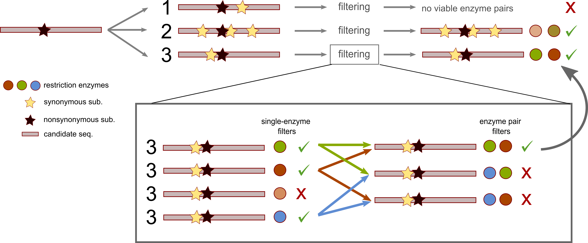

Welcome to TIARS Designer's Documentation!
==========================================

TIARS (Test for Added Recognition Sites) Designer generates a list of potential CRISPR repair oligo candidates for a provided locus that contain silent Restriction Fragment Length Polymorphisms (RFLP's) for two distinct restriction enzymes in addition to the desired edit.  This allows users to:

* Consider all viable combinations of synonymous edits and restriction enzymes to use in an easy to view word document

* Automate the process of filtering out inviable candidate sequences and restriction enzyme pairs 

* Rank the outputted candidate sequence/Restriction enzyme combinations based on statistics such as the departure in codon frequency of the candidate sequence from the endogenous sequence

Why use this tool?
------------------

An important part of any CRISPR/Cas homology-directed repair experiment is being able to verify that the experiment was successful and the desired edit was incorporated. Introducing RFLP's to the repair via synonymous (AKA silent) substitutions to the repair oligo is one way to do so, as digestion with the enzymes that correspond to the RFLP's would reveal whether or not the repair oligo containing the edit and novel restriction sites was incorporated. TIARS Designer automates the process of figuring out where best to introduce the silent RFLP's, which is a time consuming and error prone process to do by hand.

Workflow
--------

The tool runs three main steps:

1. Generates a list of candidate sequences containing all possible combinations of silent mutations within 15 bp on either side of the Cas protein cutsite.

2. For each candidate sequence, finds all restriction enzymes that have a restriction site in the candidate sequence that's not in the endogenous sequence (meaning it was created by the silent mutations), and filters out enzymes that would not work well with that sequence (see :ref:`Single Enzyme Filters <Single-Enzyme-Filters>`). Before moving on it outputs all sequence + single restriction enzyme combinations that passed all of the filters.

3. For each candidate sequence, any enzymes that haven't been filtered out are paired together in all possible combinations, and filtered on the enzyme pair level based on the compatibility of the pair with the sequence (see :ref:`Enzyme Pair Filters <Enzyme-Pair-Filters>`. Outputs all sequence + restriction enzyme pair combinations that passed all the pair filters.

Continue through this documentation for an overview of the tool's workflow, usage, and outputs 

.. toctree::
   :maxdepth: 2
   :caption: Contents:

   getting_started
   usage
   output
   filters
   scaling_up

Indices and tables
==================

* :ref:`genindex`
* :ref:`modindex`
* :ref:`search`

