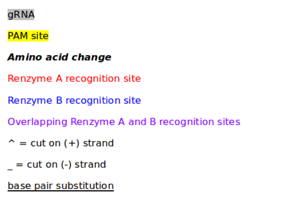
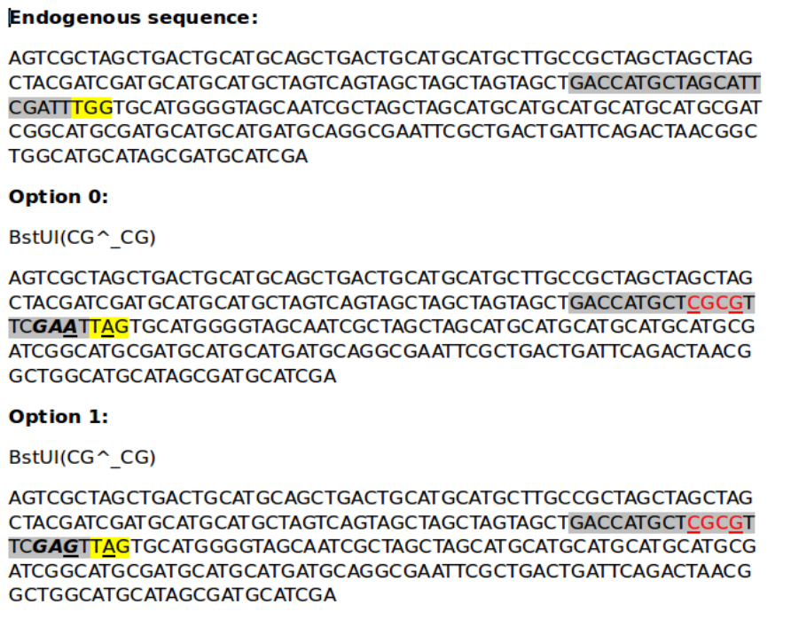
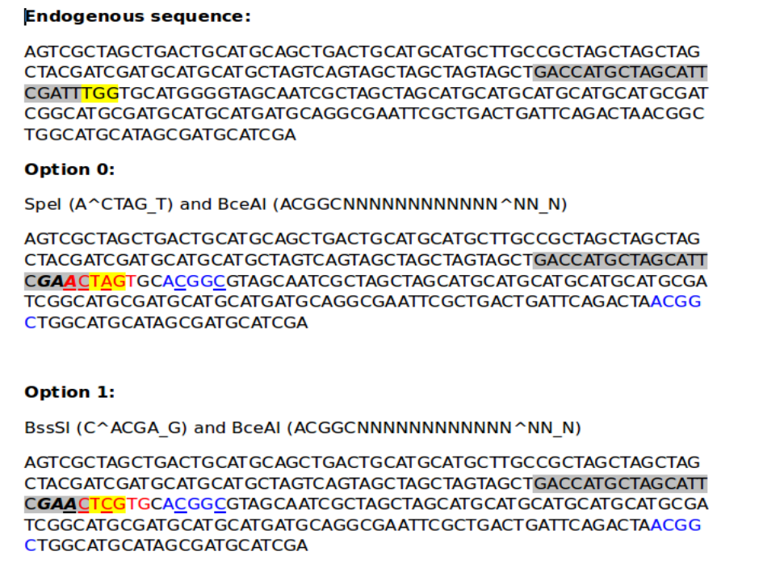

=======================
Interpreting the output
=======================
Each sample has its own output folder. In it, there is an excel spreadsheet and a word document for the single Renzyme filter results and an excel spreadsheet and a word document for the Renzyme pair filter results. The spreadsheets contain statistics such as ‘codon frequency change’ for each passing candidate-enzyme combination. These statistics can be used to sort the candidates and rank them in Cases where a lot of candidates made it to the final output. The word documents are for visualizing the passing candidates, and each candidate in the word document corresponds to a candidate in the spreadsheet with a matching candidate I.D. The documents are explained in further detail below.

.. _docx-figure-key:

Docx Figure Key
===============
Use this key to interperet the docx file example output figures

Single Enzyme results
=====================

Single Enzyme Excel sheet
-------------------------
- Filename: [sample_name]_single_Renzymes.xlsx
- Description: An excel spreadsheet containing sortable statistics for ranking the passed candidate-enzyme combos. Each row represents one sequence and one enzyme that passed all of the single enzyme filters for that sequence.
- Columns:
   +--------+-----------------------------+---------------------------------------------------------------------------------------+
   | Column | Name                        | Desription                                                                            |
   +========+=============================+=======================================================================================+
   | A      | Candidate I.D. number       | This number matches the number given to each candidate in the word document, so       |
   |        |                             | if you see a high ranking candidate in the spreadsheet, you can easily find it in     |
   |        |                             | the word doc by finding the matching option number.                                   |
   +--------+-----------------------------+---------------------------------------------------------------------------------------+
   | B      | Sequence                    | This is the full candidate sequence, although it’s much easier to view it in the      |
   |        |                             | word doc.                                                                             |
   +--------+-----------------------------+---------------------------------------------------------------------------------------+
   | C      | Renzyme                     | This is a restriction enzyme that passed all of the single enzyme filters for that    |
   |        |                             | row’s sequence.                                                                       |
   +--------+-----------------------------+---------------------------------------------------------------------------------------+
   | D      | Average distance to Cas cut | This is the distance in basepairs between the Cas cut and the cut resulting from      |
   |        |                             | the novel restriction site for this row’s Renzyme. If there’s more than one novel     |
   |        |                             | restriction site (which doesn’t appear to have happened very often), this value       |
   |        |                             | will be the average of their distances to the Cas cut.                                |
   +--------+-----------------------------+---------------------------------------------------------------------------------------+
   | E      | Codon frequency change      | This is the total difference in codon usage frequency between the candidate sequence  |
   |        |                             | and the endogenous sequence. For each codon, the absolute value of the difference in  |
   |        |                             | frequency between the two sequences was calculated. The codon frequency change is the |
   |        |                             | sum of that absolute value across all the codons in the sequence.                     |
   +--------+-----------------------------+---------------------------------------------------------------------------------------+
   | F      | Cutsite distance outside    | This is the distance outside the Renzyme’s recognition site that its cutsite falls.   |
   |        | Rsite                       | If this value is different for the + and - strand (e.g. if it cuts 3 bp outsite the   |
   |        |                             | recognition site on the + strand and 5 bp outside the recognition site on the -       |
   |        |                             | strand), this value takes the greater of the two. For example, BpuEI has the          |
   |        |                             | recognition site ‘CTTGAG’, but its cut actually looks like this                       |
   |        |                             | ‘CTTGAGNNNNNNNNNNNNNN_NN^N’ (‘^’ = + strand cut, ’_’ = - strand cut). In this Case,   |
   |        |                             | the cutsite distance outside the Rsite would be 17.                                   |
   +--------+-----------------------------+---------------------------------------------------------------------------------------+

Single Enzyme Word Document
---------------------------

- Filename: [sample_name]_single_Renzymes.docx
- Description: A word document for visualising all of the sequence-enzyme combinations that passed all of the single enzyme filters, with the PAM site, guideRNA, Restriction sites, and substitutions all mapped out. The option numbers in the word doc match the candidate IDs in the spreadsheet (column A) so you can easily find a candidate from the spreadsheeteven after sorting.
- example:

See :ref:`Docx Figure Key <docx-figure-key>`

Enzyme Pair results
===================

Enzyme Pair Excel sheet
-----------------------
- Filename: [sample_name]_Renzyme_pairs.xlsx
- Description: an excel spreadsheet containing sortable statistics for ranking all of the passed candidate-enzyme pair combos. Each row represents a candidate sequence and a pair of enzymes that each passed all of the single enzyme filters and as a pair passed all of the enzyme pair filters for that sequence.
- Columns:
   +--------+------------------------------------+----------------------------------------------------------------------------------+
   | Column | Name                               | Description                                                                      |
   +========+====================================+==================================================================================+
   | A      | candidate ID number                | See single enzyme spreadsheet column A description                               |
   +--------+------------------------------------+----------------------------------------------------------------------------------+
   | B      | sequence                           | See single enzyme spreadsheet column B description                               |
   +--------+------------------------------------+----------------------------------------------------------------------------------+
   | C      | Renzyme Pair                       | A pair of restriction enzymes that passed all of the enzyme pair filters. The    |
   |        |                                    | first enzyme listedis referred to as RenzymeA in later columns, and the second   |
   |        |                                    | enzyme listed is RenzymeB (e.g. if it’s “FauI and HpyAV”, FauI is RenzymeA and   |
   |        |                                    | HpyAV is RenzymeB)                                                               |
   +--------+------------------------------------+----------------------------------------------------------------------------------+
   | D      | RenzymeA avg distance to Cas cut   | See single enzyme spreadsheet column D description                               |
   +--------+------------------------------------+----------------------------------------------------------------------------------+
   | E      | RenzymeA cutsite distance outsite  | See single enzyme spreadsheet column F description                               |
   |        | Rsite                              |                                                                                  |
   +--------+------------------------------------+----------------------------------------------------------------------------------+
   | F      | RenzymeB avg distance to Cas cut   | See single enzyme spreadsheet column D description                               |
   +--------+------------------------------------+----------------------------------------------------------------------------------+
   | G      | RenzymeB cutsite distance outsite  | See single enzyme spreadsheet column F description                               |
   |        | Rsite                              |                                                                                  |
   +--------+------------------------------------+----------------------------------------------------------------------------------+
   | H      | Codon frequency change             | See single enzyme spreadsheet column E description                               |
   +--------+------------------------------------+----------------------------------------------------------------------------------+
   | I      | Overall average distance from Cas  | The average of columns D and F                                                   |
   |        | cut                                |                                                                                  |
   +--------+------------------------------------+----------------------------------------------------------------------------------+

Enzyme Pair Word Document
-------------------------
- Name: [sample_name]_Renzyme_pairs.docx

- Description: A word document for visualizing all of the sequence-enzyme pair combinations that passed all of the enzyme pair filters, with the PAM site, gRNA, Restriction sites, and substitutions all mapped out. The option numbers in the word doc match the candidate ID’s in the spreadsheet (column A) so you can easily find a candidate from the spreadsheet even after sorting.

- Example:

See :ref:`Docx Figure Key <docx-figure-key>`

